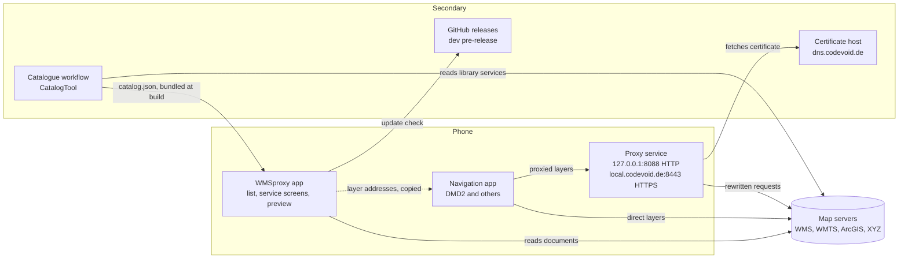
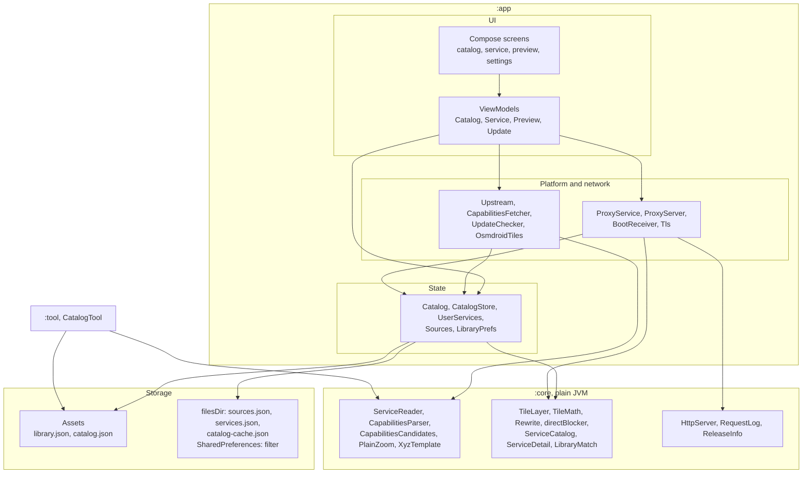

# Architecture

## High-level architecture

Primary components are on the phone and the map servers. Secondary components supply
the certificate, the updates and the shipped catalogue.

## Block diagram

Arrows point from a block to the block it uses.

There is no database. State is a set of JSON files, described under State below.

## Modules

| Module | Role |
|---|---|
| `:core` | Everything that does not need Android: parsing service documents, tile templates and tile math, the list and detail models, the direct-or-proxy rule, the HTTP server, the request log, release parsing. Plain JVM, tested with JUnit. |
| `:app` | The Android app: the proxy service, the stores, the Compose screens. Depends on `:core`. |
| `:tool` | `CatalogTool`, a JVM command-line program that writes `catalog.json`. Depends on `:core`. Never part of the APK. |
| `tools/` | `check-library.py` measures library entries. `service-list.py` writes the library section of `docs/service-catalogue.md`. |

## Tile request path

1. The navigation app requests `/tileproxy/<source>[/<layer>]/{z}/{x}/{y}` from
   `ProxyServer`, on either listener.
2. `ProxyServer` looks the source up in `Sources` on every request, so edits take
   effect on the next tile.
3. `TileLayer.urlFor` expands the upstream template: padded zoom, flipped row, quadkey,
   WMS bounding box, subdomain.
4. `Upstream` fetches the tile, adding the Referer if the layer has one, with at most
   six requests in flight per host.
5. A raster image is relayed unchanged. Anything else, and any failure, is a 502.
6. Every request, and what became of it, goes into `RequestLog`.

`/probe` answers every request with a blank tile and logs it, so the log shows which
placeholders a client filled in.

## Reading a service

`ServiceReader.read` is used by both the app (`CapabilitiesFetcher`, over OkHttp) and
`CatalogTool` (over `java.net.http`). Each caller supplies its own HTTP GET.

1. A tile template becomes a service with one layer, with no request (`XyzTemplate`).
2. Otherwise each address from `CapabilitiesCandidates` is tried in turn and parsed by
   `CapabilitiesParser` (WMS, WMTS, or an ArcGIS REST description).
3. If a layer pads its zoom, `PlainZoom` asks the server once for a tile in the plain
   form. On an image, every layer is stored in the plain form.
4. The result is a `CachedService`: the layers that can be served, and the skipped
   ones with their reasons.

## State

Every store is a process-wide `object`, initialised in `WmsProxyApp.onCreate` and
exposed as a `StateFlow`.

| Store | File | Content |
|---|---|---|
| `Sources` | `sources.json` | Loaded layers as `TileLayer`s, and `startOnBoot` |
| `UserServices` | `services.json` | Services added by address, favorites |
| `CatalogStore` | `catalog-cache.json` | Documents the user read, overlaid on the shipped `catalog.json` |
| `LibraryPrefs` | SharedPreferences | The list's filter chips |

`Catalog` combines the library, `UserServices`, `CatalogStore` and `Sources` into the
list of `ServiceItem`s that every screen reads (`ServiceCatalog.assemble`).

## Direct or proxied

`directBlocker()` in `core/DmdLayers.kt` returns the first rewrite a layer needs that DMD
cannot do itself, or null. With null, the layer's own template is the address to use.
Otherwise it is the proxy's HTTPS template (`ProxyServer.templateFor`).

## Catalogue pipeline

1. `app/src/main/assets/library.json` is edited by hand. `check-library.py --update`
   writes the measured layer counts into it.
2. On a push that changes the library, the Catalogue workflow runs `CatalogTool`. The
   tool reads the entries that have no document yet, drops documents for entries that
   left the library, and keeps a previous document when a read fails.
3. The workflow runs `service-list.py`, then commits `catalog.json` and
   `docs/service-catalogue.md` to the same branch.
4. Started by hand, the workflow passes `--all` and reads every service again.
